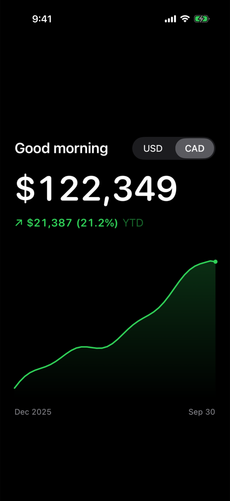

# Finance

A private net-worth dashboard for iPhone. One dark page, a scrubbable chart, USD/CAD, five time ranges and an asset breakdown, built with SwiftUI and Swift Charts.



Your balances never touch a bank API. You build a snapshot on your Mac (from CSV or JSON), encrypt it locally, and publish the ciphertext to your own [Convex](https://convex.dev) deployment. The phone pulls it on refresh with a read-only token and decrypts it. Convex never sees a balance.

## Try it in two minutes

Requirements: macOS, Xcode 26+, [XcodeGen](https://github.com/yonaskolb/XcodeGen), Node 24+.

```sh
npm ci
xcodegen generate
open Finance.xcodeproj
```

Run the **Finance** scheme on a simulator. To see the screenshot above, add the environment variable `FINANCE_DEMO_DATA=1` to the scheme (Debug builds only). To load the example CSVs instead:

```sh
node Tools/finance.ts from-csv examples/accounts.csv examples/history.csv 1.36 ~/finance/snapshot.json
node Tools/finance.ts simulator ~/finance/snapshot.json
```

## Use it for real

[docs/setup.md](docs/setup.md) covers signing for your phone, deploying the backend, connecting the phone and publishing updates. [docs/data.md](docs/data.md) describes the snapshot format and CSV import. [docs/security.md](docs/security.md) explains the trust model.

## Layout

| Path | What |
| --- | --- |
| `Finance/` | SwiftUI app: dashboard, chart, validation, Keychain, encrypted refresh, cache |
| `convex/` | Encrypted snapshot storage and the authenticated read endpoint |
| `Tools/` | `finance.ts` CLI (import, encrypt, publish, provision), verification script |
| `Config/` | Build settings; your `Local.xcconfig` overrides go here |
| `examples/` | Synthetic CSVs |
| `Tests/`, `FinanceTests/` | Node and native tests |

## Verify

```sh
npm run verify   # typecheck, Node tests, native tests, Release build, private-file check
```

CI runs only when manually dispatched.

## License

[MIT](LICENSE)
